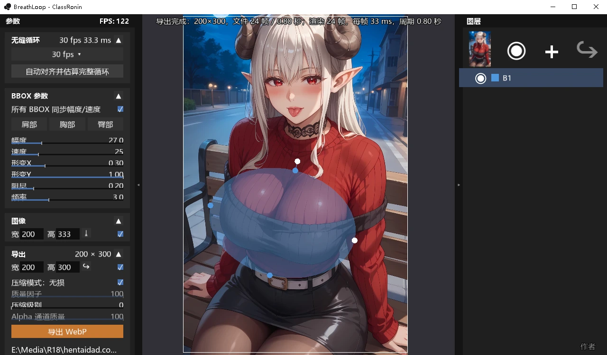

# BreathLoop 呼吸循环

用 BBOX 圈出区域做无缝呼吸循环动画，一键导出动态 WebP。
> C++ / GLFW + OpenGL 全自绘界面，无 GUI 框架依赖。
> 从静图生成无缝呼吸循环动图（WebP），单文件 C++ 桌面工具。

---

下载：[BreathLoop.zip](BreathLoop.zip)

---

---

# 快捷键

## 键盘

| 键 | 效果 |
| :---: | --- |
| `Ctrl+T` | 进入自由变换（选中图层） |
| `Enter` | 变换中：提交变形；套索中：闭合套索 |
| `Esc` | 变换中：放弃变形并还原；套索中：取消套索；否则清空选择 |
| `E` | 开 / 关橡皮（从套索切过来会清掉套索） |
| `A` | 无套索时开始画套索；正在画时丢掉这一笔；已闭合时清除套索 |
| `Delete` | 套索中：删掉最后一个套索点 |
| `Delete` | 选中 BBOX 时：删除该 BBOX；多选时：删除所有选中；套索闭合且橡皮关：剪掉套索内像素（保留图层）；否则删除选中图层 |
| `Ctrl+C` | 有闭合套索：把套索内像素抠进剪贴板；否则复制选中内容 |
| `Ctrl+X` | 剪走套索内的像素（图层保留，像素被擦掉，可 `Ctrl+V` 贴成新层） |
| `Ctrl+V` | 粘贴：BBOX 剪贴板贴成新图层；图层剪贴板落回原位 |
| `Ctrl+A` | 全选 |
| `Ctrl+Z` | 撤销 |
| `Ctrl+Shift+Z` | 重做 |
| `X` | 切换 X 模式（隐藏 BBOX 与形变，图像不呼吸） |
| `空格`（点一下即松） | 切换 BBOX 覆盖层显示 |
| `空格` + 拖 | 平移视图（与中键同口径，不动图层） |
| `Home` | 视图适配画布 |

## 鼠标

| 操作 | 效果 |
| :---: | --- |
| 中键拖 | 平移视图 |
| 滚轮 | 以光标为中心缩放视图（不缩放图层） |
| `Ctrl` + 点击图层 / BBOX | 加选 / 减选（多选） |
| 拖动中按住 `Ctrl` | 移动时吸附到画布与其它图层的边线 / 中心线 |
| 双击图层 | 进入自由变换（若已有闭合套索则先清套索） |
| 双击某个点闭合套索 | 闭合（少一点、同一点再点一次也算） |
| 双击 BBOX 名字 | 进入改名 |
| 拖角缩放（变换中） | 默认以图像中心对称缩放；按住 `Alt` 改为对角锚点不动 |
| 拖角缩放时按 `Ctrl` | 解除等比，横竖自由 |
| 拖角圆点 | 旋转（绕图层中心） |
| 图层行拖放：落在缩略图上 | 成为该图层的子层 |
| 图层行拖放：落在行上半 | 排到目标图层前面 |
| 图层行拖放：落在行下半 | 排到目标图层后面 |

---

